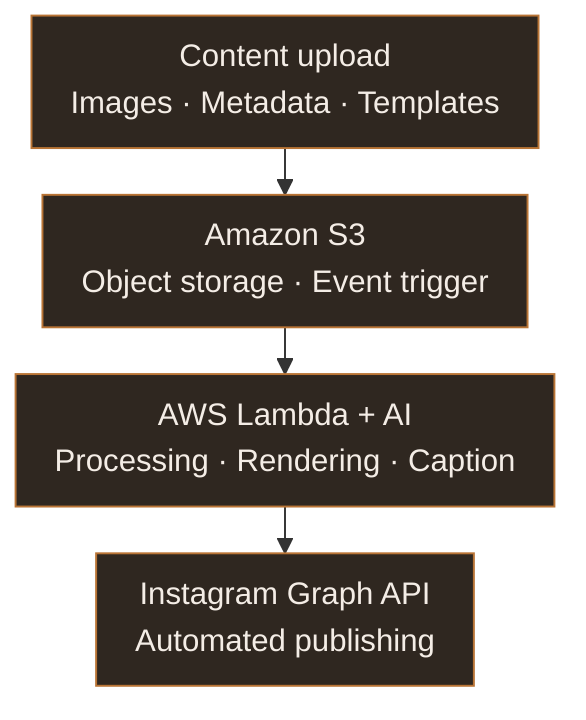

# Hey, I'm Léna! 👋

### Software Development · Cloud & DevOps · Architecture

I'm a software developer with a growing interest in cloud infrastructure, system architecture and automation.

I love designing systems, building products from scratch and automating things that probably didn't need to be automated in the first place.

## About me

- 💻 Currently working @ Vosgelis — software development, troubleshooting, IT architecture and technical decision-making.
- 🎓 MSc in Cloud & Cybersecurity @ Epitech, with a focus on Cloud & DevOps.
- ☁️ Currently learning AWS, Kubernetes, Terraform and Ansible.
- 🛠️ Working towards a career in Cloud & DevOps engineering, with a long-term interest in architecture.
- ⚡ Women in Tech advocate, founder of Soror'IT and regular attendee of tech events.

I see technologies as tools, not identities. I enjoy choosing the right stack for the problem rather than adapting the problem to the stack.

## Technical stack

| | Technologies |
|---|---|
| Languages | C#, PHP, JavaScript, TypeScript, SQL |
| Development | .NET, Laravel, Vue.js, React |
| Databases | MySQL, PostgreSQL, SQL Server |
| Systems & DevOps | Linux, Docker, Git, GitHub Actions, CI/CD |
| Currently learning | AWS, Kubernetes, Terraform, Ansible |

## Side projects

**AI-powered content automation**

Designing a serverless, event-driven architecture on AWS to automate content creation and social media publishing.

`AWS` · `Serverless` · `Event-driven` · `AI` · `Automation` · `IaC`

*Target architecture · Project in development*

**Homelab & self-hosting**

Experimenting with networking, infrastructure and self-hosted services on Raspberry Pi. Because apparently, having a perfectly functional home network isn't enough.

## Beyond tech

I'm an outdoor enthusiast, whitewater kayaker, skier, horse rider, gamer and traveller.

Apparently, debugging isn't enough adrenaline for me.

I'm also passionate about making the tech industry more inclusive and encouraging more women to pursue technical careers.

## Let's connect

[LinkedIn](https://www.linkedin.com/in/lenagonzalezbreton/) · [Portfolio](https://lenagonzalezbreton.fr/) · [Email](mailto:lena.gbreton@proton.me)
